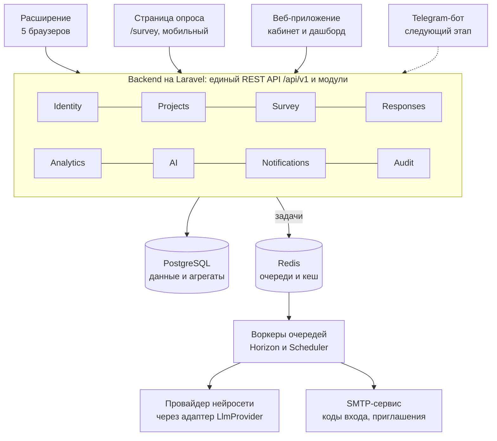

# ТЗ: «Пульс команды» — система пульс-опросов (пилот)

Версия от 27.10.2026

## 1. Общие сведения

Нужно разработать пилотную версию системы, в которой сотрудники команды по рабочим дням проходят короткий пульс-опрос (около 4 вопросов, до 60 секунд), а руководитель видит динамику ответов и может получить AI-сводку о состоянии команды. «Пульс команды» — рабочее название.

### 1.1. Цели пилота

1. Дать руководителю команды регулярный и быстрый сигнал о состоянии людей: энергия, нагрузка, настроение, блокеры.
2. Проверить на своей команде, что сотрудники готовы отвечать регулярно. Целевой отклик — не ниже 70% рабочих дней.
3. Заложить архитектуру, на которую позже без переписывания добавятся Telegram-бот, интеграции с таск-трекерами, платные алерты и биллинг.

### 1.2. Состав системы

1. **Веб-приложение** — кабинет владельца и администраторов проекта: настройка опроса, участники, дашборд, AI-сводки.
2. **Браузерное расширение** — основной канал, через который сотрудник проходит опрос.
3. **Веб-страница опроса** — альтернативный канал для тех, кто не может или не хочет ставить расширение.
4. **Backend и API** — единый для всех каналов.

### 1.3. Входит в пилот

Всё, что описано в разделах 2–9 и в приложении А.

### 1.4. Не входит в пилот, но учитывается в архитектуре

Telegram-бот, интеграции с таск-трекерами (Jira, Яндекс Трекер и др.), автоматические алерты (будущая платная услуга), тарифы и оплата, мобильные приложения. Подробнее в разделе 10.

### 1.5. Глоссарий

| Термин | Значение |
| --- | --- |
| Аккаунт | Учётная запись человека в системе, привязана к email. Один аккаунт может состоять в нескольких проектах |
| Проект | Одна команда. Внутри проекта — участники, настройки опроса, ответы, сводки |
| Участник | Аккаунт, состоящий в проекте, с ролью: владелец, администратор или сотрудник |
| Код приглашения | Секретный код проекта, по которому сотрудник подаёт заявку на вступление. Сам по себе не даёт права отвечать |
| Опрос дня | Набор вопросов, зафиксированный на конкретный рабочий день проекта |
| Канал ответа | Способ пройти опрос: расширение, веб-страница, в будущем Telegram |
| Индекс команды | Сводный показатель 0–100 по вопросам, отмеченным как «входит в индекс» (п. 7.3) |
| AI-сводка | Текстовый анализ ответов за период, построенный нейросетью по запросу администратора |

## 2. Роли и права доступа

В каждом проекте три роли: владелец, администратор и сотрудник. Роль задаётся отдельно для каждого проекта: один и тот же аккаунт может быть владельцем в одном проекте и сотрудником в другом.

### 2.1. Правила ролей

1. **Владелец** — создатель проекта. В проекте ровно один владелец. Только он назначает и меняет роли.
2. **Администратор** — те же права, что у владельца, кроме назначения и смены ролей, передачи владения и удаления проекта.
3. **Сотрудник** — проходит опрос. Доступа к кабинету проекта, ответам коллег и статистике не имеет.
4. Владелец и администраторы по умолчанию тоже могут проходить опрос. Это регулируется флагом участника «Участвует в опросах», который включает или выключает владелец или администратор.
5. Права проверяются на backend для каждого запроса (Laravel Policies или Gates). Скрытие кнопок в интерфейсе защитой не считается.

### 2.2. Матрица прав

| Действие | Владелец | Администратор | Сотрудник |
| --- | --- | --- | --- |
| Проходить опрос (при включённом флаге участия) | Да | Да | Да |
| Видеть дашборд, ответы поимённо, комментарии | Да | Да | Нет |
| Настраивать вопросы, порядок, ротацию | Да | Да | Нет |
| Настраивать параметры проекта (название, часовой пояс, язык по умолчанию) | Да | Да | Нет |
| Видеть и перевыпускать код приглашения | Да | Да | Нет |
| Одобрять и отклонять заявки на вступление | Да | Да | Нет |
| Исключать сотрудников | Да | Да | Нет |
| Исключать администраторов | Да | Нет | Нет |
| Назначать и снимать роль администратора | Да | Нет | Нет |
| Запускать AI-сводку и видеть историю сводок | Да | Да | Нет |
| Экспортировать данные (CSV, PDF) | Да | Да | Нет |
| Передать владение другому администратору | Да | Нет | Нет |
| Удалить проект | Да | Нет | Нет |
| Видеть журнал действий (п. 9.1) | Да | Да | Нет |

Пункты «Передать владение» и «Удалить проект» — предложение заказчика по умолчанию, подтверждается на старте работ.

### 2.3. Владение аккаунтом

1. Любой зарегистрированный аккаунт может создать новый проект и становится в нём владельцем.
2. Владелец не может покинуть проект, пока не передаст владение.
3. Владелец удаляет проект только после подтверждения: ввод названия проекта и код из письма.

## 3. Архитектура и технологический стек

Система — модульный монолит на Laravel с единым REST API для всех каналов ответа. Фоновые задачи выполняются через Laravel Queue на Redis, отдельный брокер сообщений в пилоте не нужен.



Расширение и страница опроса вызывают одни и те же эндпоинты. Письма и запросы к нейросети выполняют воркеры очереди. Telegram-бот подключится позже как ещё один канал.

### 3.1. Стек

| Слой | Технология | Примечание |
| --- | --- | --- |
| Backend | PHP (актуальная стабильная версия), Laravel (актуальная стабильная версия) | Обязательно |
| База данных | PostgreSQL 16+ | Обязательно |
| Очереди, кеш, rate limiting | Redis + Laravel Queue + Laravel Horizon | Обязательно |
| Периодические задачи | Laravel Scheduler | Обязательно |
| Аутентификация API | Laravel Sanctum: токены для расширения, сессии для веб-приложения | Обязательно |
| Frontend веб-приложения | Inertia (Vue или React) либо Livewire | Выбор подрядчика, согласовать на старте |
| Графики | Любая поддерживаемая библиотека (ECharts, Chart.js и т. п.) | Выбор подрядчика |
| Расширение | TypeScript, WebExtensions API, Manifest V3, один код для всех браузеров (рекомендуется WXT или аналог) | Обязательно |
| Окружение | Docker Compose для разработки и продакшена, Nginx + PHP-FPM | Обязательно |

### 3.2. Модули backend

Код разделяется на модули с явными границами. Модуль не обращается к таблицам другого модуля напрямую, только через его сервисы или события.

1. **Identity** — аккаунты, вход по коду из письма, токены устройств, согласие на обработку ПДн.
2. **Projects** — проекты, участники, роли, коды приглашения, заявки на вступление.
3. **Survey** — вопросы, наборы, ротация, расписание, «опрос дня».
4. **Responses** — ответы, комментарии (включая анонимные), каналы ответа.
5. **Analytics** — агрегаты, индекс команды, данные дашборда, экспорт.
6. **AI** — адаптер нейросетей, промпты, псевдонимизация, история сводок (раздел 8).
7. **Notifications** — отправка писем (коды, приглашения, уведомления о заявках).
8. **Audit** — журнал действий администраторов.

### 3.3. Каналы ответа

1. Расширение и веб-страница опроса используют одни и те же эндпоинты API.
2. Каждый ответ хранит поле `channel` (`extension`, `web`; в будущем `telegram`).
3. Добавление нового канала не должно требовать изменений в модулях Survey, Responses и Analytics.

### 3.4. API

1. REST, JSON, версионирование по пути: `/api/v1/...`.
2. Спецификация OpenAPI 3 поддерживается в репозитории и обновляется вместе с кодом.
3. Единый формат ошибок: код, сообщение, поле (для ошибок валидации).
4. Ответы API локализуются по заголовку `Accept-Language` (ru, en).

### 3.5. Асинхронная обработка

1. Через очередь выполняются: отправка писем, запросы к нейросети, пересчёт агрегатов, генерация PDF-экспорта.
2. Очереди разделены по назначению (например, `mail`, `ai`, `analytics`, `default`), чтобы медленные запросы к нейросети не задерживали письма с кодами входа.
3. Задачи идемпотентны, имеют повторные попытки с увеличивающейся паузой и логируют окончательный сбой.
4. Через Scheduler выполняются: открытие «опроса дня» по часовому поясу каждого проекта, ночной пересчёт агрегатов, очистка просроченных кодов и заявок.
5. Драйвер очереди задаётся конфигурацией. Замена Redis на RabbitMQ или другой брокер не должна требовать изменения бизнес-кода.

### 3.6. Доменные события

Система публикует события Laravel: `MemberJoined`, `SurveyDayOpened`, `ResponseSubmitted`, `SurveyDayClosed`, `SummaryGenerated`. В пилоте на них подписаны только агрегаты и аудит. Это точки расширения для будущих алертов и Telegram-бота (раздел 10).

### 3.7. Время и даты

1. Все метки времени хранятся в UTC.
2. «День опроса» — локальная дата в часовом поясе проекта, хранится отдельным полем типа `date`.

## 4. Регистрация, вход и вступление в проект

Вход везде беспарольный: email и одноразовый код из письма. Сотрудник вступает в проект по коду приглашения, подтверждает email и ждёт одобрения администратора. Код приглашения сам по себе не даёт права отвечать.

### 4.1. Вход по коду из письма (общий механизм)

1. Пользователь вводит email, система отправляет 6-значный код.
2. Код действует 10 минут, допускается 5 попыток ввода. После этого нужен новый код.
3. Повторная отправка кода — не чаще раза в 60 секунд, не более 10 писем в час на один email.
4. При первом входе пользователь указывает имя и язык интерфейса (ru, en).
5. При первом входе показывается отдельный экран согласия на обработку ПДн с отдельной галочкой (п. 9.2). Без согласия работа невозможна.

### 4.2. Регистрация владельца и создание проекта (веб)

1. Пользователь входит по п. 4.1.
2. Нажимает «Создать проект», указывает название, часовой пояс (по умолчанию — часовой пояс браузера) и язык по умолчанию.
3. Система создаёт проект, назначает пользователя владельцем, генерирует код приглашения и базовый набор вопросов из приложения А.
4. Владелец видит экран «Пригласите команду»: код приглашения, ссылки на установку расширения и на веб-страницу опроса, кнопку «Скопировать текст приглашения».

### 4.3. Вступление сотрудника через расширение

1. Сотрудник устанавливает расширение и открывает его.
2. Вводит код приглашения. Система показывает название проекта для подтверждения.
3. Вводит email и проходит вход по п. 4.1. Если аккаунт уже существует, имя и согласие повторно не запрашиваются.
4. Расширение получает персональный токен устройства (п. 4.5).
5. Система создаёт заявку на вступление со статусом «Ожидает одобрения». Расширение показывает этот статус.
6. Владелец и администраторы получают письмо о новой заявке и видят счётчик заявок в кабинете.
7. Администратор одобряет или отклоняет заявку. При одобрении сотрудник получает роль «Сотрудник».
8. Расширение проверяет статус заявки при открытии и периодически (п. 6.2). После одобрения показывает опрос, после отклонения — сообщение «Заявка отклонена».
9. Отклонённый пользователь может подать заявку повторно.

Опциональная настройка проекта (по умолчанию выключена): автоматически одобрять заявки с email на указанном домене, например `@company.ru`.

### 4.4. Вступление через веб-страницу опроса

Тот же сценарий, что в п. 4.3, но в браузере: код приглашения → email → код из письма → заявка → ожидание. Сессия веб-страницы живёт 30 дней.

### 4.5. Токены устройств

1. Токен выдаётся на аккаунт и конкретное устройство (название: браузер и ОС). Хранится в базе только в виде хэша.
2. Токен действует, пока его не отозвали. Выход в расширении отзывает токен.
3. В профиле веб-приложения пользователь видит свои устройства и может отозвать любое.
4. Исключение из проекта закрывает доступ к этому проекту, но не отзывает токен целиком: доступ к другим проектам аккаунта сохраняется.

### 4.6. Код приглашения

1. Случайная строка не короче 12 символов в удобном для ввода виде, например `K7QX-2M9P-WD4R`.
2. Владелец или администратор может перевыпустить код. Старый код сразу перестаёт работать, уже поданные заявки сохраняются.
3. Ввод кода ограничен 10 попытками в минуту с одного IP.

### 4.7. Несколько проектов

1. Один аккаунт может состоять в нескольких проектах.
2. В расширении есть кнопка «Добавить проект» (ввод ещё одного кода приглашения) и переключатель между проектами.
3. Бейдж на иконке учитывает непройденные опросы по всем проектам (п. 6.2).

### 4.8. Исключение участника

1. При исключении администратор выбирает, что сделать с ответами: оставить в статистике (имя показывается как «Бывший участник») или удалить.
2. Анонимные комментарии исключённого участника не удаляются, так как система не знает их автора (п. 6.5).

## 5. Управление опросом

Администратор сам собирает опрос: выбирает вопросы из базового банка или создаёт свои, задаёт порядок перетаскиванием и включает ротацию. Опрос проводится с понедельника по пятницу по часовому поясу проекта, по умолчанию из 4 вопросов.

### 5.1. Типы вопросов

| Тип | Настройки | Как хранится ответ |
| --- | --- | --- |
| Шкала | Диапазон (по умолчанию 1–5, допускается до 1–10), подписи крайних значений, режим отображения: цифры или эмодзи | Число |
| Ползунок | Минимум, максимум, шаг, подписи крайних значений | Число |
| Одиночный выбор | От 2 до 8 вариантов. У варианта: текст, необязательный эмодзи, необязательный числовой вес для аналитики | Идентификатор варианта |
| Множественный выбор | То же, что одиночный выбор, плюс максимум выбранных вариантов | Список идентификаторов |
| Открытый ответ | Короткий (до 200 символов) или длинный (до 2000 символов) | Текст |

### 5.2. Общие атрибуты вопроса

1. Текст на русском (обязательно) и на английском (необязательно). Если английского текста нет, сотруднику с английским интерфейсом показывается русский.
2. Подсказка под вопросом (необязательно, ru и en).
3. Обязательный или нет.
4. Для шкалы, ползунка и вариантов с весами — флаг «Входит в индекс команды» и направление: «больше — лучше» или «больше — хуже» (п. 7.3).
5. Категория из справочника: энергия, нагрузка, настроение, вовлечённость, ясность задач, команда, восстановление, блокеры, другое. Используется в фильтрах дашборда и в AI-сводке.

### 5.3. Библиотека вопросов

1. **Базовый банк** — системные вопросы из приложения А. Только для чтения. Администратор добавляет вопрос в проект кнопкой «Добавить», и в проекте создаётся его копия.
2. **Вопросы проекта** — создание, редактирование, дублирование, архивирование.
3. Вопрос, на который уже есть ответы, нельзя удалить, только архивировать. Архивные вопросы не попадают в опрос, но остаются в статистике.

### 5.4. Изменение вопроса, на который уже отвечали

1. Любое изменение текста или вариантов создаёт новую версию вопроса. Каждый ответ ссылается на ту версию, на которую он дан.
2. На дашборде вопрос показывается одной линией через все версии, точка смены версии отмечается на графике.
3. При изменении диапазона шкалы или набора вариантов система предупреждает, что история станет несопоставимой, и предлагает вместо этого создать новый вопрос.

### 5.5. Состав опроса и ротация

1. **Режим «Фиксированный»** (по умолчанию): каждый день одни и те же вопросы в заданном порядке.
2. **Режим «С ротацией»**: закреплённые вопросы показываются каждый день, плюс N вопросов из пула ротации.
3. Выбор из пула: «по очереди» или «случайно без повторов, пока пул не исчерпан».
4. Ротационные вопросы ставятся после закреплённых.
5. Порядок закреплённых вопросов и состав пула меняются перетаскиванием.
6. Всего вопросов в день — от 1 до 10. При количестве больше 6 система показывает предупреждение, что длинный опрос снижает отклик.
7. Кнопка «Предпросмотр» показывает опрос так, как его увидит сотрудник, на ru и en.

### 5.6. Расписание

1. Опрос проводится по рабочим дням, понедельник–пятница. Дни недели хранятся настройкой проекта, чтобы позже их можно было сделать редактируемыми. Интерфейс для их изменения в пилоте не нужен.
2. День опроса открывается в 00:00 и закрывается в 23:59 по часовому поясу проекта.
3. Каждый участник отвечает не больше одного раза в день. До закрытия дня ответ можно изменить, хранится последняя версия.
4. Пропущенные дни заполнить задним числом нельзя.
5. Желательно: администратор может отметить отдельные даты как нерабочие (праздники). Производственный календарь в пилоте не нужен.

### 5.7. «Опрос дня»

1. При открытии дня Scheduler фиксирует набор вопросов этого дня, включая выбор из ротации.
2. Все участники проекта в этот день получают одинаковые вопросы, это нужно для сопоставимости ответов.
3. Изменения, сделанные в течение дня, применяются со следующего рабочего дня. Интерфейс сообщает об этом при сохранении.

### 5.8. Набор по умолчанию

При создании проекта в нём автоматически настраивается фиксированный опрос из 4 вопросов базового набора (приложение А, раздел А.2).

## 6. Прохождение опроса

Сотрудник проходит опрос в расширении или на веб-странице за один экран, до 60 секунд. После отправки видит надпись «Молодец!». Бейдж на иконке расширения напоминает о непройденном опросе, других напоминаний в пилоте нет.

### 6.1. Расширение: браузеры и публикация

| Браузер | Сборка | Публикация |
| --- | --- | --- |
| Google Chrome | Chromium, Manifest V3 | Chrome Web Store |
| Яндекс Браузер | Та же сборка, что для Chrome | Устанавливается из Chrome Web Store |
| Microsoft Edge | Chromium, Manifest V3 | Microsoft Edge Add-ons |
| Mozilla Firefox | Сборка для Firefox | Firefox Add-ons (AMO) |
| Safari | Safari Web Extension, упаковка через Xcode | App Store, нужен аккаунт Apple Developer заказчика |

Аккаунты разработчика во всех магазинах принадлежат заказчику. Подрядчик готовит сборки и материалы для публикации и проводит расширение через модерацию.

### 6.2. Расширение: разрешения и бейдж

1. Минимальные разрешения: `storage`, `alarms` и доступ только к домену API. Расширение не читает содержимое страниц, вкладки и историю браузера. Это нужно явно указать в описании расширения в магазинах.
2. Бейдж на иконке показывает число проектов, где сегодняшний опрос не пройден.
3. Статус проверяется при запуске браузера, при открытии расширения, раз в 60 минут (через `alarms`) и сразу после отправки ответа.
4. В нерабочие дни бейдж не показывается. После отправки ответа бейдж гаснет.
5. Системные уведомления в пилоте не используются.

### 6.3. Экраны расширения

1. Подключение к проекту: ввод кода приглашения, email, кода из письма (раздел 4).
2. Ожидание одобрения заявки.
3. Опрос дня.
4. «Молодец!» (en: «Well done!») — 2–3 секунды после отправки.
5. «Опрос на сегодня пройден» с кнопкой «Изменить ответ» (до конца дня).
6. «Сегодня опроса нет» — в выходные и нерабочие дни.
7. Переключатель проектов и кнопка «Добавить проект».
8. Настройки: язык интерфейса, выход (отзывает токен устройства).

### 6.4. Форма опроса

1. Все вопросы дня на одном экране с прокруткой. Размер окна расширения — до 400 × 600 px.
2. Обязательные вопросы проверяются перед отправкой, незаполненные подсвечиваются.
3. Работает с клавиатуры: Tab, стрелки для шкал, Enter для отправки.
4. Если окно закрыли, не отправив ответ, введённые значения сохраняются локально до конца дня.
5. При ошибке сети ответ не теряется: показывается сообщение и кнопка «Повторить».

### 6.5. Комментарий и анонимность

1. В конце формы — необязательное поле «Комментарий» до 1000 символов.
2. Под полем — галочка «Отправить анонимно» с подсказкой: администратор увидит комментарий без имени, но в небольшой команде автора иногда можно узнать по стилю.
3. Анонимный комментарий хранится в отдельной таблице только с идентификатором проекта и датой дня опроса. Без идентификатора пользователя, без точного времени, без IP. Тело запроса не попадает в логи приложения.
4. Анонимный комментарий нельзя изменить или удалить после отправки, так как система не знает автора. Подписанный комментарий можно изменить до закрытия дня.
5. Если в проекте меньше 3 участников опроса, галочка анонимности недоступна, и рядом показывается причина.

### 6.6. Веб-страница опроса

1. Адрес вида `/survey`, вход по п. 4.1.
2. Показывает список проектов пользователя со статусом сегодняшнего опроса и ту же форму, что расширение.
3. Адаптивная вёрстка, корректно работает в мобильном браузере от 360 px по ширине.

### 6.7. Язык интерфейса

Язык берётся из настроек аккаунта. При первом запуске, до входа, — из языка браузера (ru, иначе en).

## 7. Дашборд и аналитика

На странице проекта владелец и администраторы видят индекс команды, участие, динамику по каждому вопросу, тепловую карту «участник × день» и ленту комментариев. Ответы видны поимённо. Любой срез можно экспортировать в CSV или PDF.

### 7.1. Фильтры

1. Период: 7 дней, 30 дней, 90 дней, текущий месяц, произвольный.
2. Участник: все или один.
3. Категория вопроса (п. 5.2) и конкретный вопрос.
4. Фильтры сохраняются в URL, чтобы ссылкой на срез можно было поделиться с другим администратором.

### 7.2. Состав дашборда

1. **Карточки показателей:** индекс команды за период и его изменение к предыдущему такому же периоду; участие в процентах; число активных участников; число новых комментариев.
2. **Индекс команды по дням** — линия, пунктиром тот же показатель за предыдущий период.
3. **Участие по дням** — столбцы: сколько ответили из ожидаемых.
4. **Тепловая карта «участник × день»:** цвет ячейки — личный индекс за день, серый — нет ответа. Клик по ячейке открывает ответы этого участника за этот день.
5. **Числовые вопросы** (шкала, ползунок): среднее по команде по дням с разбросом от минимума до максимума, распределение ответов за период.
6. **Вопросы с выбором:** распределение вариантов за период и динамика по неделям.
7. **Открытые ответы и комментарии:** лента с фильтрами по участнику, дате и вопросу. Анонимные комментарии помечены и показываются без имени.
8. **Карточка участника:** личный индекс по дням, ответы на каждый вопрос, участие, последние комментарии, сравнение с медианой команды.

### 7.3. Индекс команды

Индекс — число от 0 до 100. Он считается только по вопросам с флагом «Входит в индекс». Каждый ответ сначала приводится к шкале 0–100:

```
s = (v − v_min) / (v_max − v_min) × 100
```

1. Для вопросов с направлением «больше — хуже» используется 100 − s.
2. Для вопросов с выбором v — вес выбранного варианта, а v_min и v_max — минимальный и максимальный веса вариантов этого вопроса. Для множественного выбора берётся среднее весов выбранных вариантов.
3. Личный индекс за день — среднее s по ответам участника за этот день.
4. Индекс команды за день — среднее личных индексов ответивших в этот день.
5. Индекс за период — среднее индексов команды за дни периода.
6. Рядом с каждым значением показывается число ответивших. Если в день ответил 1 человек, точка помечается «мало данных».

### 7.4. Участие

Участие за период = число полученных ответов / (число участников с включённым флагом участия × число рабочих дней периода). Участник учитывается только с даты одобрения заявки и до даты исключения.

### 7.5. Экспорт

1. **CSV ответов:** одна строка на ответ — дата, участник, вопрос, версия вопроса, значение, текст, канал.
2. **CSV комментариев:** дата, текст, автор или пометка «анонимно».
3. **PDF-отчёт** по текущему срезу дашборда с графиками.
4. Экспорт формируется в фоне через очередь, готовый файл появляется в интерфейсе и доступен для скачивания 24 часа.
5. Каждый экспорт записывается в журнал действий.

### 7.6. Производительность

1. Дашборд проекта на 50 участников за 365 дней открывается не дольше 2 секунд.
2. Дневные агрегаты пересчитываются при отправке ответа (по событию `ResponseSubmitted`) и ночью полностью.

## 8. AI-сводка

По кнопке администратор получает от нейросети текстовую сводку за выбранный период: общая динамика, на кого и на что обратить внимание, что идёт хорошо. В нейросеть уходят только псевдонимизированные данные. Провайдер подключается через адаптер: новая нейросеть добавляется одним классом-реализацией и записью в конфигурации.

### 8.1. Сценарий

1. На дашборде администратор нажимает «AI-сводка».
2. Выбирает период (по умолчанию последние 10 рабочих дней, максимум 90 дней) и охват: вся команда или один участник.
3. Нажимает «Сформировать». Создаётся задача в очереди `ai`, в интерфейсе статус «Формируется».
4. Когда сводка готова, она появляется на экране без перезагрузки страницы и сохраняется в историю.
5. При ошибке показывается понятное сообщение и кнопка «Повторить».

### 8.2. Какие данные отправляются

1. **Отправляются:** псевдоним участника («Участник 1», «Участник 2» и т. д.), дата, категория и текст вопроса, ответ (исходное значение и значение по шкале 0–100), тексты комментариев с пометкой «анонимно», дневной индекс команды и участие.
2. **Не отправляются:** имена, email, название проекта и компании.
3. Таблица соответствия «псевдоним → участник» создаётся на каждый запрос, хранится только у нас и не уходит провайдеру.
4. В текстах ответов и комментариев имена и фамилии участников проекта и их email заменяются псевдонимами по словарю участников. Замена делается по возможности: свободный текст может содержать и другие личные сведения, это указывается в интерфейсе.
5. Если данных за период больше лимита контекста модели, вместо сырых ответов отправляются дневные агрегаты по участникам плюс все тексты.

### 8.3. Формат ответа нейросети

Нейросеть возвращает строгий JSON по схеме:

```json
{
  "summary": "общий вывод в 3-5 предложениях",
  "team_trend": "динамика команды за период",
  "attention": [
    {"who": "Участник 3 или null для всей команды", "reason": "что настораживает", "evidence": ["даты и вопросы, на которых основан вывод"]}
  ],
  "positive": ["что идёт хорошо"],
  "recommendations": ["что можно сделать руководителю"],
  "data_quality": "достаточно ли данных для выводов"
}
```

1. Ответ проверяется по схеме. При несоответствии — одна повторная попытка, затем ошибка.
2. После проверки псевдонимы заменяются обратно на имена, и только после этого сводка показывается администратору.

### 8.4. Отображение и хранение

1. Над каждой сводкой — постоянное предупреждение: сводка сформирована нейросетью, носит рекомендательный характер, не является медицинской оценкой и основанием для кадровых решений, выводы нужно проверять в разговоре с сотрудником.
2. В истории сохраняются: текст сводки, период, охват, провайдер, модель, версия промпта, токены на входе и выходе, стоимость (если провайдер её возвращает), кто запросил, когда.
3. Владелец и администраторы видят историю сводок проекта и могут удалить сводку.

### 8.5. Адаптер провайдеров

1. Единый интерфейс, например `LlmProvider::generate(LlmRequest): LlmResponse`. Запрос: системный промпт, сообщения, требуемый формат JSON, максимум токенов, температура, таймаут.
2. Ошибки провайдеров приводятся к общим исключениям: превышен лимит запросов, таймаут, ошибка авторизации, некорректный ответ.
3. Провайдеры регистрируются в конфигурации (`config/ai.php`), активный выбирается переменной окружения для всей системы.
4. Добавление нового провайдера — новый класс и запись в конфигурации, без изменений в остальном коде.
5. В пилоте реализуются один реальный провайдер (выбор — в разделе 12) и тестовый `FakeProvider`, который возвращает заранее заданный JSON.

### 8.6. Промпты

1. Промпты хранятся в репозитории как версионированные шаблоны (например, `resources/prompts/summary/v1.ru.md`), а не строками в коде.
2. Промпт явно запрещает ставить диагнозы, требует ссылаться на конкретные ответы и отмечать, когда данных мало.
3. Первую версию промпта подрядчик составляет вместе с заказчиком, заказчик её утверждает.

### 8.7. Ограничения

1. Не более 20 сводок на проект в сутки. Значение задаётся в конфигурации.
2. Таймаут запроса к провайдеру — 120 секунд, не более 2 повторных попыток.
3. Ключи API провайдеров хранятся только в переменных окружения.

## 9. Нефункциональные требования

Система обрабатывает персональные данные сотрудников и их самооценку состояния, поэтому требования к безопасности, разграничению доступа и 152-ФЗ обязательны уже в пилоте.

### 9.1. Безопасность

1. Только HTTPS, включён HSTS.
2. Защита от уязвимостей из OWASP Top 10, CSRF-защита веб-приложения.
3. Ограничение частоты запросов: вход, отправка кодов, ввод кода приглашения, API опроса.
4. Токены и коды хранятся только в виде хэшей. Секреты — только в переменных окружения.
5. Администратор одного проекта не может получить данные другого проекта. Это покрывается автотестами на каждый эндпоинт.
6. Зависимости проверяются на известные уязвимости в CI (`composer audit`, `npm audit`).
7. **Журнал действий:** смена ролей, одобрение, отклонение и исключение участников, перевыпуск кода приглашения, изменение вопросов, экспорт, запрос AI-сводки, удаление проекта. Хранится: кто, что, когда, над каким объектом. Срок хранения — 1 год.

### 9.2. Персональные данные (152-ФЗ)

1. Серверы и база данных размещаются в РФ.
2. Согласие на обработку ПДн — отдельный экран с отдельной галочкой, не совмещённый с другими документами. Сохраняются версия текста согласия и время принятия. При новой версии согласия пользователь принимает её при следующем входе.
3. Тексты согласия и политики обработки ПДн предоставляет заказчик. Они хранятся в системе так, чтобы их можно было обновить без релиза.
4. В профиле пользователь может скачать свои данные (JSON или CSV) и удалить аккаунт. При удалении удаляются аккаунт и подписанные ответы. Анонимные комментарии остаются, так как не связаны с автором.
5. С ответами не хранятся IP-адреса. Логи веб-сервера хранятся не дольше 30 дней.
6. В интерфейсе не используются медицинские термины и формулировки-диагнозы («выгорание», «депрессия» и т. п.). Используются «энергия», «нагрузка», «самочувствие».

### 9.3. Надёжность и эксплуатация

1. Ежедневная резервная копия базы с хранением 14 дней. Восстановление из копии проверяется до запуска пилота.
2. Эндпоинт проверки здоровья (`/health`): база, Redis, очереди.
3. Мониторинг ошибок (Sentry или self-hosted аналог).
4. Панель Horizon доступна только системному администратору.

### 9.4. Качество кода

1. Стиль: Laravel Pint для PHP, ESLint и Prettier для TypeScript.
2. Статический анализ: Larastan (PHPStan) не ниже 6 уровня.
3. Тесты:
    1. feature-тесты на каждый эндпоинт API, включая проверку матрицы прав из п. 2.2;
    2. unit-тесты на расчёт индекса, ротацию, «опрос дня» с учётом часового пояса, псевдонимизацию.
4. Покрытие тестами модулей Survey, Responses, Analytics и AI — не ниже 70%.
5. CI запускает линтеры, статический анализ и тесты на каждый merge request. Без зелёного CI слияние запрещено.
6. Миграции обратимы.
7. Сидер демо-данных: проект на 8 участников с ответами за 60 рабочих дней. Нужен для разработки, демонстрации и ВКР.

### 9.5. Производительность

1. Отправка ответа на опрос — не дольше 500 мс (95-й перцентиль).
2. Дашборд — по п. 7.6.

### 9.6. Локализация

1. Все строки интерфейса, писем и ошибок — в языковых файлах ru и en, без текста в коде.
2. Даты и числа форматируются по языку пользователя. Письма отправляются на языке получателя.

### 9.7. Браузеры и экраны

1. Веб-приложение: две последние версии Chrome, Edge, Firefox, Safari, Яндекс Браузера.
2. Веб-страница опроса — от 360 px по ширине. Кабинет и дашборд — от 1280 px, на мобильном достаточно корректного чтения.
3. Контрастность — не ниже WCAG AA, основные действия доступны с клавиатуры.

## 10. Задел на следующие этапы

Эти функции в пилоте не реализуются, но архитектура должна позволить добавить их без переделки существующих модулей. В таблице указано, что нужно заложить уже сейчас.

| Будущая функция | Что заложить в пилоте |
| --- | --- |
| Telegram-бот | Значение `telegram` в перечне каналов ответа. Таблица привязанных внешних идентичностей аккаунта (провайдер, внешний идентификатор). Логика опроса в сервисе, не зависящем от интерфейса: получить опрос дня, отправить ответ. API опроса отдаёт описание вопросов (тип, варианты, ограничения), достаточное для отрисовки в боте. Тогда для бота останутся сам бот и привязка Telegram к аккаунту по одноразовому коду |
| Интеграция с таск-трекерами (Jira, Яндекс Трекер и др.) | Пустой модуль Integrations: таблица подключений (тип, зашифрованные учётные данные, настройки) и интерфейс коннектора. Сопоставление участника с пользователем трекера по email. Модуль Analytics спроектирован так, чтобы принимать метрики не только из опросов |
| Автоматические алерты (платная услуга) | Доменные события из п. 3.6. Механизм флагов функций на уровне проекта: флаг `alerts` есть, по умолчанию выключен |
| Тарифы и оплата | Те же флаги функций плюс поле тарифа у проекта (по умолчанию `pilot`). Лимиты (число участников, сводок в сутки) читаются из конфигурации тарифа, а не зашиты в код |
| Мобильные приложения | Отдельной работы не нужно: API с токенами устройств уже подходит |
| Установка у клиента (on-premise) | Вся конфигурация через переменные окружения, развёртывание через Docker Compose. Нет жёстких зависимостей от внешних SaaS, кроме провайдера нейросети и SMTP |

## 11. Состав поставки

Результат работ — исходный код в репозитории заказчика, работающая установка и документация, по которой другой разработчик сможет развернуть и развивать систему без участия подрядчика.

1. **Исходный код** backend, веб-приложения и расширения в Git-репозитории заказчика с полной историей коммитов. Все права на код переходят заказчику.
2. **Развёртывание:** Docker Compose для разработки и продакшена, пример `.env`, инструкция по установке «с нуля» на чистый сервер.
3. **Установленная система** на сервере заказчика с настроенными HTTPS, резервным копированием и мониторингом ошибок.
4. **Расширение:** сборки для всех браузеров из п. 6.1, опубликованные в магазинах через аккаунты заказчика.
5. **Документация:**
    1. README: архитектура, модули, запуск локально, тесты;
    2. спецификация API (OpenAPI 3);
    3. описание модели данных (ER-диаграмма);
    4. инструкция по добавлению нового провайдера нейросети;
    5. краткое руководство администратора проекта.
6. **CI** с линтерами, статическим анализом и тестами (п. 9.4).
7. **Сидер демо-данных** (п. 9.4).

## 12. Открытые вопросы

Эти пункты согласуются с подрядчиком до начала разработки.

- [ ] Сроки, бюджет, разбивка на этапы и критерии приёмки.
- [ ] Кто делает дизайн интерфейса: подрядчик или заказчик предоставляет макеты.
- [ ] Frontend-стек веб-приложения: Inertia (Vue или React) или Livewire (п. 3.1).
- [ ] Первый провайдер нейросети для пилота и где он обрабатывает данные (п. 8.5).
- [ ] Хостинг в РФ и кто администрирует сервер после запуска.
- [ ] Сервис отправки писем (SMTP).
- [ ] Тексты согласия на обработку ПДн и политики обработки ПДн (готовит заказчик).
- [ ] Подтвердить права «Передать владение» и «Удалить проект» (п. 2.2).
- [ ] Нужна ли в пилоте отметка нерабочих дней (п. 5.6).
- [ ] Название продукта и домен.

## Приложение А. Базовый банк вопросов

Банк состоит из набора по умолчанию (4 вопроса, из них 2 шкалы 1–5) и пула из 14 вопросов для ротации. Он загружается сидером как системная библиотека (п. 5.3). Администратор может менять любые формулировки в своём проекте.

### А.1. Принципы

1. Вопросы покрывают три стороны рабочего выгорания, которые выделяют исследователи: истощение, отстранённость от работы и снижение ощущения результативности. Плюс нагрузка, ясность задач, команда, восстановление и блокеры.
2. Это не клинический инструмент и не диагностика. Формулировки собственные, пункты лицензируемых методик (например, MBI) не копируются.
3. Тон «средний»: лёгкие метафоры, без канцелярита и без сюсюканья. Обращение на «ты», как принято в большинстве IT-команд. Если в команде принято «вы», администратор меняет формулировки.
4. Каждый вопрос отвечается за 5–10 секунд.

### А.2. Набор по умолчанию

| № | Вопрос (ru) | Вопрос (en) | Тип и варианты (вес) | Категория | В индексе |
| --- | --- | --- | --- | --- | --- |
| 1 | Какой у тебя сегодня заряд батареи? | What's your battery level today? | Шкала 1–5: 1 «Почти на нуле», 5 «Заряжен полностью» | Энергия | Да, больше — лучше |
| 2 | Насколько сегодняшняя нагрузка тебе по силам? | How manageable is today's workload? | Шкала 1–5: 1 «Явный перебор», 5 «Вполне комфортно» | Нагрузка | Да, больше — лучше |
| 3 | Если бы твой рабочий день был погодой, то какой? | If your workday were weather, what would it be? | Одиночный выбор: Ясно (4), Переменная облачность (3), Пасмурно (2), Гроза (1) | Настроение | Да |
| 4 | Что сегодня больше всего мешает работать? | What's getting in your way the most today? | Множественный выбор, до 2: Ничего, всё в порядке; Непонятная постановка задач; Жду других людей или решений; Встречи и отвлечения; Баги и техдолг; Слишком много задач сразу; Усталость | Блокеры | Нет |

### А.3. Пул для ротации

| № | Вопрос | Тип и варианты (вес) | Категория | В индексе |
| --- | --- | --- | --- | --- |
| 5 | Остались ли вчера силы на что-то своё после работы? | Выбор: Да, с запасом (4), Немного (3), Почти нет (2), Совсем нет (1) | Восстановление | Да |
| 6 | Насколько тебе сегодня интересно то, чем ты занимаешься? | Шкала 1–5: «Скучно до зевоты» — «Затянуло» | Вовлечённость | Да |
| 7 | Если бы сегодняшнюю задачу можно было отдать кому-то другому, отдал бы? | Выбор: Нет, хочу сам (3), Всё равно (2), Да, с радостью (1) | Вовлечённость | Да |
| 8 | Получилось ли сегодня довести что-то до конца? | Выбор: Да (3), Частично (2), Нет (1) | Результативность | Да |
| 9 | Чувствуешь, что твоя работа на что-то влияет? | Шкала 1–5: «Совсем нет» — «Ещё как» | Результативность | Да |
| 10 | Насколько понятно, что делать дальше? | Шкала 1–5: «Туман» — «Ясно как день» | Ясность задач | Да |
| 11 | Если застрянешь, понятно, к кому идти за помощью? | Выбор: Да (3), Не очень (2), Нет (1) | Команда | Да |
| 12 | Как тебе сегодня в команде? | Шкала 1–5 в режиме эмодзи | Команда | Да |
| 13 | Во сколько вчера закончил работать? | Выбор: Вовремя (4), Задержался до часа (3), Задержался больше чем на час (2), Работал и поздно вечером (1) | Восстановление | Да |
| 14 | Сколько сегодня удалось поработать без отвлечений? | Выбор: Меньше 30 минут (1), 30–60 минут (2), 1–2 часа (3), Больше 2 часов (4) | Нагрузка | Да |
| 15 | Заметили ли на этой неделе твой вклад? | Выбор: Да (3), Не уверен (2), Нет (1) | Команда | Да |
| 16 | Одно слово про твой сегодняшний день? | Открытый, короткий | Настроение | Нет |
| 17 | Что одно могло бы сделать завтра лучше? | Открытый, длинный | Блокеры | Нет |
| 18 | Как прошла неделя: от «понедельник навсегда» до «хочу ещё такую»? | Шкала 1–5 | Настроение | Да |

Английские формулировки для пула готовит заказчик на этапе наполнения контента.

### А.4. Рекомендации по использованию

1. Вопросы 1 и 2 стоит оставлять закреплёнными: на них строится основная динамика.
2. Открытые вопросы 16–17 лучше пускать в ротацию, а не задавать каждый день, иначе их начинают пропускать.
3. Вопрос 18 уместен по пятницам. Привязка вопроса к дню недели — желательная доработка механизма ротации (п. 5.5).
4. Через 4 недели пилота набор стоит пересмотреть: убрать вопросы, на которые все отвечают одинаково или которые чаще пропускают.
