# ADR-0004. Модель данных

**Статус:** Принято
**Дата:** 2026-10-27
**Связано:** ТЗ п. 3.7, 4, 5, 6.5, 7, 9.1.7, 9.2.4, 10, прил. А; CLAUDE.md «Опрос и время», «Персональные данные»; backlog F-019–F-033, F-040–F-049, F-059, F-075–F-077, G-06, G-07, G-08, G-16, G-17, Q-14, Q-16–Q-20; решения заказчика В-02, В-03, В-04, В-05, В-11, В-13

## Контекст

Ключевые требования к данным:
- Все метки времени в UTC; «день опроса» — локальная дата в TZ проекта, тип `date`.
- Набор вопросов дня фиксируется при открытии дня; изменения настроек действуют со следующего рабочего дня.
- Изменение вопроса, на который уже отвечали, создаёт версию; ответ ссылается на версию; на графике вопрос остаётся одной линией через все версии.
- Один ответ участника в день, изменяемый до закрытия дня; поле `channel`.
- Анонимный комментарий — отдельная таблица без `user_id`, времени и IP. Порог «< 3» считается по **фактически ответившим за день** (В-02).
- Удаление проекта и аккаунта — **мягкое** (`deleted_at`), физическое удаление делается вручную (В-05).
- Код приглашения ищется по HMAC и показывается из зашифрованной копии (В-03).
- После удаления аккаунта остаётся минимальная запись о согласии (В-11).
- Дашборд 50 × 365 открывается не дольше 2 с; агрегаты пересчитываются по событию и ночью.
- Модули не читают чужие таблицы (ADR-0001).

## Решение

### Общие соглашения

- PostgreSQL, первичные ключи `bigint identity`. Исключение — `anonymous_comments.id`: случайный UUID v4, не последовательный и не упорядоченный по времени (ADR-0005).
- Все метки — `timestamptz`, приложение и БД работают в UTC. Локальная дата — `local_date date`. Часовой пояс проекта — IANA-имя (`Europe/Moscow`).
- Мультиязычные тексты — `jsonb` вида `{"ru": "...", "en": "..."}`.
- Миграции лежат в модуле-владельце (`Modules/<M>/Database/Migrations`) и обратимы.
- Изоляция проектов — на уровне приложения: в каждой проектной таблице есть `project_id`, доступ идёт через Policy и scope в репозитории. Row Level Security в R1 не используем (ADR-0008).

### Мягкое удаление (В-05)

| Таблица | `deleted_at` | Когда ставится | Что скрывается |
| --- | --- | --- | --- |
| `users` | да | Удаление аккаунта пользователем | Вход невозможен; в кабинете показывается «Удалённый пользователь» |
| `projects` | да | Удаление проекта владельцем (после ввода названия и кода из письма) | Проект недоступен всем; Scheduler его пропускает; данные внутри скрыты через проверку проекта, своя колонка дочерним таблицам не нужна |
| `responses` | да | Удаление аккаунта (во всех проектах) и исключение участника с удалением ответов (временное решение до ответа на В-15) | Ответ, его `response_answers` и подписанный комментарий выпадают из аналитики, ленты, экспорта и порога анонимности; агрегаты пересчитываются |

- Используется стандартный `SoftDeletes` Laravel (global scope), чтобы мягко удалённые строки не попали ни в один запрос по умолчанию.
- **Физически и сразу** удаляются учётные данные, которые не нужно восстанавливать: `personal_access_tokens`, сессии, `login_codes`; в R2 — записи словаря псевдонимов (В-04).
- При удалении аккаунта активные `memberships` закрываются (`removed_at`), `pending`-заявки отклоняются.
- Физическое удаление мягко удалённого — artisan-команды системного администратора (`privacy:purge-user`, `privacy:purge-project`), запускаются вручную. Они вызывают `purge*` у всех реализаций `PersonalDataLifecycle` (ADR-0001). Срок, в который это нужно делать, — вопрос юристу (`docs/legal-questions.md`).
- Уникальность email: `unique(email) WHERE deleted_at IS NULL`. Повторная регистрация с тем же email создаёт **новый** аккаунт, мягко удалённый не восстанавливается автоматически.

### Сущности по модулям

**Identity**
- `users` — `email citext`, `name`, `locale`, timestamps, `deleted_at`.
- `login_codes` — `email`, `code_hash` (HMAC), `purpose` (`login`, `delete_project`), `attempts`, `expires_at`, `consumed_at`. Чистится по расписанию.
- `personal_access_tokens` (Sanctum) — токены устройств: `name` (браузер, ОС), `client` (`extension`, позже `mobile`), `last_used_at`, `expires_at null`.
- `consent_documents` — `kind` (`pdn_consent`, `privacy_policy`), `version`, `body jsonb` (ru/en), `published_at`. Публикуются без релиза (ADR-0005).
- `user_consents` — `user_id` (**без внешнего ключа**), `consent_document_id`, `accepted_at`. Без IP, email и имени. Это и есть минимальная запись о согласии из В-11: «дата, версия, ID». При физическом удалении пользователя она остаётся. Статус — вопрос юристу.
- `external_identities` — `user_id`, `provider` (`telegram`…), `external_id`, `unique(provider, external_id)`. Задел, в R1 пустая.

**Projects**
- `projects` — `name`, `timezone`, `default_locale`, `plan` (по умолчанию `pilot`), `work_days smallint[]` (по умолчанию `{1,2,3,4,5}`, ISO), timestamps, `deleted_at`.
- `project_features` — `project_id`, `feature`, `enabled`; PK `(project_id, feature)`. Нет строки — действует значение по умолчанию из `config/features.php` (`alerts` = false).
- `memberships` — `project_id`, `user_id`, `role` (`owner`, `admin`, `employee`), `participates bool`, `approved_at`, `removed_at`, `removal_mode` (`keep`, `delete`). Частичные уникальные индексы: один активный membership на `(project_id, user_id)` и один активный `owner` на проект. «Ровно один владелец»: «не больше одного» гарантирует индекс, «не меньше одного» — сервис. Повторное вступление — новая строка (история; поведение — Q-30).
- `invite_codes` — `project_id`, `code_hash` (HMAC-SHA256 нормализованного кода, уникальный, для поиска), `code_encrypted` (копия для показа владельцу и администраторам), `revoked_at`, `created_by` (В-03). Ключ HMAC и ключ шифрования — отдельные переменные env, не `APP_KEY` (ADR-0007). При перевыпуске старая строка получает `revoked_at`, а её `code_encrypted` обнуляется: отозванный код показывать не нужно.
- `join_requests` — `project_id`, `user_id`, `status` (`pending`, `approved`, `rejected`), `decided_by`, `decided_at`. Частичный уникальный индекс: одна `pending` на `(project_id, user_id)`.
- Рабочий календарь — сервис `WorkCalendar` (пока только `work_days`). Таблица праздников появится с F-027 без изменения потребителей.

**Survey**
- `questions` — `project_id null` (null = системный банк, только чтение), `source_question_id` (копия из банка), `category`, `status` (`active`, `archived`), `current_version_id`.
- `question_versions` — неизменяемый снимок всего, что влияет на ответ и индекс: `question_id`, `version_no`, `type` (`scale`, `slider`, `single_choice`, `multi_choice`, `open_text`), `text jsonb`, `hint jsonb`, `required`, `in_index`, `direction` (`higher_better`, `higher_worse`), `settings jsonb`. Варианты выбора — в `settings.options[]`: `{key, text, emoji, weight}`, где `key` — стабильный UUID варианта, который сохраняется между версиями при правке текста. Это даёт «одну линию» для распределений через версии.
- Правило версий: если текущая версия ещё не использовалась (нет ответов, не попадала в опрос дня), правка меняет её на месте; иначе создаётся новая версия. Какие поля считаются «существенными» (веса, флаг индекса, направление, обязательность — Q-17), решает сервис; схема поддерживает любой ответ.
- `survey_configs` — одна строка на проект: `mode` (`fixed`, `rotation`), `rotation_count`, `rotation_strategy` (`sequential`, `random_no_repeat`), `rotation_state jsonb` (курсор или оставшийся пул).
- `survey_config_items` — `project_id`, `question_id`, `slot` (`pinned`, `pool`), `position`.
- `survey_days` — `project_id`, `local_date`, `status` (`open`, `closed`), `opens_at`, `closes_at` (UTC-границы локального дня), `closed_at`; `unique(project_id, local_date)`.
- `survey_day_questions` — `survey_day_id`, `position`, `question_id`, `question_version_id`, `source` (`pinned`, `rotation`). **Это и есть фиксация «опроса дня»**: настройки можно менять сколько угодно, уже открытый день не меняется.

**Responses**
- `responses` — `project_id`, `survey_day_id`, `local_date`, `user_id`, `membership_id`, `channel` (`extension`, `web`, `telegram`), `comment` (подписанный, ≤ 1000 символов), `submitted_at`, `updated_at`, `deleted_at`; `unique(survey_day_id, user_id)`. Никаких IP и user-agent.
- `response_answers` — `response_id`, `question_id`, `question_version_id`, `value_numeric numeric null`, `value_options jsonb null` (массив `key`), `value_text text null`. При изменении ответа строки заменяются: хранится последняя версия (п. 5.6.3). Скрываются вместе с родительским `responses`.
- `anonymous_comments` — `id uuid v4`, `project_id`, `local_date`, `body`. Без timestamps, без `user_id`, без связи с `responses`. При удалении аккаунта остаются (п. 9.2.4); при удалении проекта скрыты вместе с проектом.
- **Доступность анонимности (В-02)** считает Responses по своей таблице: число неудалённых `responses` за текущий `survey_day` в момент запроса, включая ответ самого автора. Анонимный комментарий принимается, только если у автора уже есть ответ за этот день и счётчик ≥ 3. Порог задан в конфигурации. Снимок ожидаемых участников из Analytics для порога **не используется**.

**Analytics** (только производные данные, пересчитываемые с нуля)
- `daily_member_stats` — `project_id`, `local_date`, `membership_id`, `expected bool`, `answered bool`, `personal_index numeric null`. Строки ожидаемых участников создаются при `SurveyDayOpened` по списку активных участников с флагом участия (через сервис Projects). Если участника одобрили днём, строка добавляется по `MemberJoined` (В-13). Снимок нужен **только для участия** (знаменатель, G-08, Q-18) и тепловой карты; к порогу анонимности он больше отношения не имеет.
- `daily_project_stats` — `project_id`, `local_date`, `team_index`, `respondents`, `expected`, `signed_comments`, `anonymous_comments`.
- `daily_question_stats` — `project_id`, `local_date`, `question_id`, `question_version_id`, `n`, `avg`, `min`, `max`, `distribution jsonb`.
- `exports` — `project_id`, `requested_by`, `kind` (`csv_answers`, `csv_comments`; `pdf` — R2), `filters jsonb`, `status`, `path`, `expires_at` (+24 ч), `error`.
- Мягко удалённые ответы в агрегаты не попадают: Analytics читает данные через контракт Responses, а он их не отдаёт.
- Индекс считает чистый класс `TeamIndexCalculator` (unit-тесты, п. 7.3). Краевые случаи весов (G-07, Q-16) — его параметры.
- Задел под трекеры — контракт `MetricSource`; агрегаты опроса — первая его реализация.

**Audit** — `audit_log`: `project_id`, `actor_user_id null`, `action`, `subject_type`, `subject_id`, `meta jsonb` (только идентификаторы и значения настроек, без имён и email), `created_at`. Своего `deleted_at` у журнала нет: записи хранятся 1 год и при мягком удалении проекта или аккаунта не меняются. Имя автора подставляется при показе, у мягко удалённого — «Удалённый пользователь».

**Integrations** — `integration_connections`: `project_id`, `type`, `credentials` (шифруется cast-ом `encrypted`), `settings jsonb`. Задел, в R1 пустая.

**AI (R2)** — `ai_summaries` (текст с псевдонимами, метаданные из п. 8.4.2) и `ai_summary_pseudonyms` (`summary_id`, `pseudonym`, `membership_id`). Запись словаря физически удаляется при удалении аккаунта или исключении участника с удалением ответов (В-04); после этого в тексте остаётся просто «Участник N». Детали — ADR в R2.

### ER-диаграмма (основное)

```mermaid
erDiagram
    users ||--o{ personal_access_tokens : "устройства"
    users ||..o{ user_consents : "без FK, переживает удаление"
    consent_documents ||--o{ user_consents : ""
    users ||--o{ external_identities : "задел"
    users ||--o{ memberships : ""
    projects ||--o{ memberships : ""
    projects ||--o{ invite_codes : "hash + encrypted"
    projects ||--o{ join_requests : ""
    users ||--o{ join_requests : ""
    projects ||--o{ project_features : ""
    projects ||--o{ questions : ""
    questions ||--o{ question_versions : ""
    projects ||--|| survey_configs : ""
    survey_configs ||--o{ survey_config_items : ""
    projects ||--o{ survey_days : ""
    survey_days ||--o{ survey_day_questions : "фиксация дня"
    question_versions ||--o{ survey_day_questions : ""
    survey_days ||--o{ responses : "счётчик для порога анонимности"
    memberships ||--o{ responses : ""
    responses ||--o{ response_answers : ""
    question_versions ||--o{ response_answers : ""
    projects ||--o{ anonymous_comments : "только project_id + local_date"
    projects ||--o{ daily_member_stats : "снимок ожидаемых — для участия"
    projects ||--o{ daily_project_stats : ""
    projects ||--o{ daily_question_stats : ""
    projects ||--o{ exports : ""
    projects ||--o{ audit_log : ""
    projects ||--o{ integration_connections : "задел"

    users { timestamptz deleted_at }
    projects { timestamptz deleted_at }
    responses { timestamptz deleted_at }
```

### «Опрос дня» и время (В-13 — решено)

1. Scheduler раз в минуту вызывает `OpenDueSurveyDays`. Для каждого неудалённого проекта он вычисляет локальную дату в TZ проекта. Если это рабочий день (`WorkCalendar`) и записи в `survey_days` ещё нет, в одной транзакции создаётся день, фиксируются вопросы (закреплённые по порядку + N из пула по стратегии, с обновлением `rotation_state`), а после коммита публикуется `SurveyDayOpened`. Повтор безопасен благодаря `unique(project_id, local_date)`.
2. **При создании проекта** в рабочий день текущий день открывается сразу.
3. Если запрос к опросу пришёл раньше планировщика (задержка воркера), тот же идемпотентный сервис открывает день «лениво».
4. **Участник, одобренный днём**, отвечает в тот же день: доступ проверяется по membership на момент запроса, строка ожидаемого участника добавляется по `MemberJoined`.
5. `CloseDueSurveyDays` закрывает дни с `closes_at <= now()` и публикует `SurveyDayClosed`. Ответ принимается, пока `now() < closes_at`, то есть до 00:00 следующего локального дня.
6. При смене часового пояса проекта новый пояс действует с ближайшего неоткрытого дня; уже открытый день не пересчитывается.

### Поток ответа

`PUT response` → проверка согласия (ADR-0003) → Policy (активный участник с флагом участия) → `SurveyResponseService::submit(projectId, userId, Channel, answers)` → валидация по зафиксированным версиям дня → upsert `responses` + замена `response_answers` в транзакции → `ResponseSubmitted(projectId, localDate, membershipId)` после коммита → слушатель Analytics в очереди `analytics` пересчитывает строки дня. Синхронная часть — несколько запросов к БД, цель p95 ≤ 500 мс достижима.

## Рассмотренные альтернативы

1. **Версии через «копию вопроса» (новый `questions.id` на каждую правку).** Схема проще, но для «одной линии через версии» пришлось бы связывать цепочки. Отклонено.
2. **Варианты выбора в отдельной таблице `question_options`.** Нормализованнее, но варианты у версии и так неизменяемые, а стабильный ключ всё равно нужен. Отклонено в пользу `jsonb` внутри версии.
3. **Без `survey_days` — вычислять опрос дня на лету из настроек.** Нарушает требование фиксации и сопоставимости. Отклонено.
4. **Дашборд напрямую по `response_answers`, без агрегатов.** Analytics читал бы таблицы Responses (нарушение правила 1), а индекс и участие считались бы в каждом запросе. Отклонено.
5. **UUID v7 для всех ключей.** Пилоту это ничего не даёт, а для анонимных комментариев v7 вреден (упорядочен по времени). Отклонено.
6. **Порог анонимности по ожидаемым участникам (снимок Analytics).** Изначальная рекомендация. Отклонено заказчиком (В-02).
7. **Физическое удаление аккаунта и проекта сразу.** Изначальная рекомендация, соответствует букве ТЗ п. 9.2.4. Заказчик выбрал мягкое удаление (В-05), вопрос передан юристу.
8. **Хранить код приглашения только хэшем.** Тогда код нельзя показать повторно, а матрица п. 2.2 этого требует. Отклонено (В-03).

## Последствия

- (+) История вопросов, фиксация дня и знаменатель участия хранятся явно и проверяются unit-тестами.
- (+) Агрегаты Analytics можно в любой момент перестроить из Responses через контракт.
- (+) Мягкое удаление позволяет восстановить случайно удалённый проект.
- (−) Каждый запрос к `users`, `projects` и `responses` обязан учитывать `deleted_at`. Global scope это закрывает, но сырые запросы и отчёты нужно проверять в ревью (ADR-0008, Р-17).
- (−) Мягко удалённые ПДн физически остаются в БД до ручной очистки (ADR-0005, вопрос юристу).
- (−) `user_consents.user_id` без внешнего ключа: возможны «висячие» ID. Это сделано намеренно.
- (−) Утечка ключа шифрования раскрывает действующие коды приглашения. Ущерб ограничен: код сам по себе доступа не даёт, его можно перевыпустить.
- (−) `jsonb` для вариантов и настроек требует строгой валидации в DTO и тестов.
- Открытые вопросы, влияющие на детали, но не на схему: Q-14, Q-16, Q-17, Q-18, Q-30, В-15.
