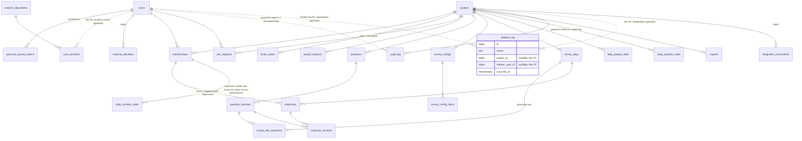

# ADR-0004. Модель данных

**Статус:** Принято
**Дата:** 2026-10-27
**Связано:** ТЗ п. 3.7, 4, 5, 6.5, 7, 7.4, 9.1.7, 9.2.4, 10, прил. А; CLAUDE.md «Опрос и время», «Персональные данные»; backlog F-014, F-019–F-033, F-040–F-049, F-059, F-066, F-075–F-077, G-07, G-08, G-16, G-17, Q-14, Q-16–Q-20; решения заказчика В-03, В-04, В-05, В-11, В-13, В-15, В-17, В-19, В-21, В-22, В-23, Q-20, отмена анонимности (ADR-0005); мелкие решения — `docs/decisions.md`

## Контекст

Ключевые требования к данным:
- Все метки времени хранятся в UTC. «День опроса» — локальная дата в часовом поясе проекта, тип `date`.
- Набор вопросов дня фиксируется при открытии дня; изменения настроек действуют со следующего рабочего дня.
- Изменение вопроса, на который уже отвечали, создаёт новую версию; ответ ссылается на версию; на графике вопрос остаётся одной линией.
- Один ответ участника в день, изменить его можно до закрытия дня. У ответа есть поле `channel`.
- **Анонимных ответов и комментариев нет** — это сознательное отступление от ТЗ п. 6.5 (ADR-0005).
- Удаление аккаунта, проекта и ответов исключённого участника — **физическое и сразу** (В-05, В-15). Связанные записи журнала удаляются целиком (В-19).
- Факт удаления фиксируется в реестре удалений без ПДн. Реестр хранится 1 год, доступен только системному администратору, интерфейса нет (В-21, В-23).
- **Участие.** Одобренный днём участник и участник, которому днём включили флаг, отвечают сразу, а в расчёт участия попадают со следующего рабочего дня (В-22а, Q-20). Если флаг выключили днём, этот день участнику не считается ни ответом, ни пропуском (В-22б).
- Код приглашения ищется по HMAC, а показывается из зашифрованной копии (В-03).
- После удаления аккаунта остаётся минимальная запись о согласии (В-11, ЮВ-2).
- Дашборд для 50 участников × 365 дней открывается не дольше 2 с.
- Модули не читают чужие таблицы (ADR-0001).

## Решение

### Общие соглашения

- PostgreSQL, первичные ключи `bigint identity`. Метки времени — `timestamptz` в UTC, локальная дата — `local_date date`, часовой пояс — IANA-имя.
- Мультиязычные тексты хранятся в `jsonb` вида `{"ru", "en"}`.
- Миграции лежат в модуле-владельце и обратимы.
- Изоляция проектов — на уровне приложения: `project_id` + Policy + scope.
- Колонок `deleted_at` нет, удаление всегда физическое.

### Удаление (В-05, В-15, В-17, В-19, В-21)

Удаление выполняется синхронно в одной транзакции через реестр `PersonalDataLifecycle` (ADR-0001). Порядок модулей: AI → Analytics → Responses → Survey → Audit → Projects → Identity. В той же транзакции пишется строка в `deletion_log`. После коммита пересчёт агрегатов уходит в очередь `analytics`.

| Действие | Удаляется физически сразу | Остаётся | Запись в `deletion_log` |
| --- | --- | --- | --- |
| Удаление аккаунта (п. 9.2.4) | `users`; `personal_access_tokens`; сессии; `login_codes` по email; `external_identities`; `memberships` и `join_requests`; `responses` и `response_answers` во всех проектах; `daily_member_stats` его участий; файлы `exports` его проектов; все `audit_log`, где пользователь — автор или объект; в R2 — записи словаря | `user_consents` (ЮВ-2) | `account_deleted`, `project_id = null`, инициатор — сам пользователь |
| Исключение «оставить ответы» (п. 4.8) | В R2 — запись словаря (В-17) | `memberships` с `removed_at`; ответы как «Бывший участник»; записи журнала | — (обычная запись в `audit_log`) |
| Исключение «удалить ответы» (В-15) | `responses`, `response_answers`, `daily_member_stats` этого участия; в R2 — запись словаря | `memberships` с `removed_at`; записи журнала | `member_responses_deleted`, `project_id`, инициатор — владелец или администратор |
| Удаление проекта (название + код из письма) | Всё с этим `project_id` во всех модулях, включая все `audit_log` проекта | — | `project_deleted`, `project_id`, инициатор — владелец |

- Email уникален (`unique(email)`), повторная регистрация создаёт новый аккаунт.
- Резервные копии (14 дней) содержат удалённые данные до истечения срока (ЮВ-3).

### Сущности по модулям

**Identity**
- `users`: `email citext unique`, `name`, `locale`, timestamps.
- `login_codes`: `email`, `code_hash` (HMAC), `purpose` (`login`, `delete_project`), `attempts`, `expires_at`, `consumed_at`.
- `personal_access_tokens` (Sanctum): `name`, `client`, `last_used_at`, `expires_at null`.
- `consent_documents`: `kind`, `version`, `body jsonb`, `published_at`.
- `user_consents`: `user_id` (**без внешнего ключа**), `consent_document_id`, `accepted_at`. Без IP, email и имени (В-11, ЮВ-2).
- `external_identities`: `user_id`, `provider`, `external_id` (задел).

**Projects**
- `projects`: `name`, `timezone`, `default_locale`, `plan` (`pilot`), `work_days smallint[]`, timestamps.
- `project_features`: PK `(project_id, feature)`, `enabled`.
- `memberships`: `project_id`, `user_id`, `role`, `participates`, `participates_changed_at`, `approved_at`, `removed_at`, `removal_mode`. Частичные уникальные индексы: один активный membership на `(project_id, user_id)` и один активный `owner` на проект. Смена `participates` публикует доменное событие **`MemberParticipationChanged`** (`projectId`, `membershipId`, `participates`, `localDate`) — шестое утверждённое событие (решение заказчика).
- `invite_codes`: `project_id`, `code_hash` (HMAC, уникальный), `code_encrypted`, `revoked_at`, `created_by` (В-03).
- `join_requests`: `project_id`, `user_id`, `status`, `decided_by`, `decided_at`.
- Рабочий календарь — сервис `WorkCalendar`.

**Survey**
- `questions`: `project_id null` (банк), `source_question_id`, `category`, `status`, `current_version_id`.
- `question_versions`: неизменяемый снимок `type`, `text`, `hint`, `required`, `in_index`, `direction`, `settings jsonb`. Варианты лежат в `settings.options[]` со стабильным `key`.
- Правило версий: пока версия не использовалась, правка меняет её на месте; иначе создаётся новая (Q-17).
- `survey_configs`, `survey_config_items` — состав и ротация.
- `survey_days`: `project_id`, `local_date`, `status`, `opens_at`, `closes_at`, `closed_at`; `unique(project_id, local_date)`.
- `survey_day_questions` — фиксация «опроса дня».

**Responses**
- `responses`: `project_id`, `survey_day_id`, `local_date`, `user_id`, `membership_id`, `channel`, `comment` (≤ 1000 символов, подписан), `submitted_at`, `updated_at`; `unique(survey_day_id, user_id)`. Без IP и user-agent.
- `response_answers`: `response_id`, `question_id`, `question_version_id`, `value_numeric`, `value_options jsonb`, `value_text`.

**Analytics** (только производные данные)
- `daily_member_stats`: `project_id`, `local_date`, `membership_id`, `expected bool`, `answered bool`, `personal_index`.
- `daily_project_stats`: `team_index`, `respondents` (все ответившие), `expected`, `expected_answered`, `comments`.
- `daily_question_stats`: `n`, `avg`, `min`, `max`, `distribution jsonb`.
- `exports`: `kind`, `filters`, `status`, `path`, `expires_at` (+24 ч).
- `TeamIndexCalculator` и `ParticipationCalculator` — классы без побочных эффектов, покрыты unit-тестами (п. 7.3, 7.4). Контракт `MetricSource`.

### Участие и флаг участия (В-13, В-22, Q-20)

Единое правило: **знаменатель участия на день задаётся только снимком, сделанным при открытии дня. В течение дня снимок может уменьшиться, но не вырасти.**

| Событие в течение дня | Может ли отвечать сегодня | `expected` сегодня | Ответ сегодня в индексе и на тепловой карте | В знаменателе |
| --- | --- | --- | --- | --- |
| Снимок при открытии дня (активный участник, `participates = true`) | Да | `true` | Да | Сегодня |
| Одобрение заявки днём (`MemberJoined`) | Да, сразу (В-13) | `false` | Да | Со следующего рабочего дня (В-22а) |
| Флаг включили днём (`MemberParticipationChanged`, `true`) | Да, сразу | `false` | Да | Со следующего рабочего дня (В-22а) |
| Флаг выключили днём (`MemberParticipationChanged`, `false`) | Нет: Policy отклоняет новый ответ и изменение | Строка становится `expected = false` | Уже отправленный ответ остаётся и учитывается | Пока флаг выключен — нет (В-22б) |
| Флаг выключили и снова включили в тот же день | Да, снова | Остаётся `false` | Да | Со следующего рабочего дня |
| Исключение участника днём | Нет, доступ закрыт | Строка становится `expected = false` | При «оставить ответы» — да; при «удалить» ответ удаляется | — |

- **Формула участия (п. 7.4):** участие за период = Σ строк `expected ∧ answered` / Σ строк `expected` за рабочие дни периода. День с `expected = false` не считается участнику ни ответом, ни пропуском, поэтому участие не превышает 100%.
- Строки `daily_member_stats` с `expected = false` создаются только для тех, кто ответил: они нужны для индекса и тепловой карты.
- Кто меняет снимок:
  - снимок при открытии делает слушатель `SurveyDayOpened` в Analytics через контракт Projects;
  - выключение флага днём обрабатывает слушатель `MemberParticipationChanged`;
  - исключение участника днём обрабатывает реализация `PersonalDataLifecycle::onMemberRemoved` в Analytics, синхронно и без нового события;
  - `MemberJoined` строку `expected` не добавляет.

### Audit

- `audit_log`: `project_id`, `actor_user_id null`, `action`, `subject_type`, `subject_id`, `meta jsonb` (только идентификаторы и значения настроек), `created_at`. Хранится 1 год. При удалении пользователя или проекта связанные записи удаляются целиком (В-19).
- **`deletion_log` — реестр удалений (В-21, В-23):**

  | Колонка | Тип | Примечание |
  | --- | --- | --- |
  | `id` | `bigint identity` | — |
  | `action` | `text` (enum в коде) | `project_deleted`, `account_deleted`, `member_responses_deleted`; в R2 возможны типы для данных AI |
  | `project_id` | `bigint null`, **без внешнего ключа** | `null` для `account_deleted` |
  | `initiator_user_id` | `bigint null`, **без внешнего ключа** | Для `account_deleted` — сам удалённый пользователь (ЮВ-4) |
  | `occurred_at` | `timestamptz` | UTC |

  - Не хранит имён, email, названий, `meta` и ID исключённого участника.
  - Запись остаётся после удаления проекта и пользователя.
  - Хранится 1 год, очищается задачей Scheduler.
  - **Доступ — только у системного администратора, интерфейса нет** (В-23). Чтение — через artisan-команду. В кабинете, профиле, API и выгрузке «мои данные» реестр не показывается.

**Integrations** — `integration_connections` (задел).

**AI (R2)** — `ai_summaries` и `ai_summary_pseudonyms` (`summary_id`, `pseudonym`, `membership_id`). Запись словаря удаляется при любом исключении и при удалении аккаунта. Псевдоним без записи в словаре показывается как есть («Участник 3»).

### ER-диаграмма (основное)

### «Опрос дня» и время

1. Scheduler раз в минуту запускает `OpenDueSurveyDays`. Если наступил рабочий день, а записи дня ещё нет, в одной транзакции создаются день и набор вопросов. После коммита публикуется `SurveyDayOpened`, и Analytics делает снимок ожидаемых участников.
2. Если проект создан в рабочий день, текущий день открывается сразу.
3. Если к моменту запроса день не открыт, он открывается по этому запросу.
4. Одобренный днём участник и участник, которому днём включили флаг, отвечают сразу. В знаменатель участия они попадают со следующего рабочего дня (В-13, В-22а).
5. Если флаг выключили днём, участник больше не может отвечать, а день в участии ему не считается (В-22б).
6. Ответ принимается до 00:00 следующего локального дня. `CloseDueSurveyDays` публикует `SurveyDayClosed`.
7. Новый часовой пояс проекта действует с ближайшего неоткрытого дня.

### Поток ответа

`PUT response` → согласие → Policy (активный участник, `participates = true` на момент запроса) → `SurveyResponseService::submit(...)` → валидация по версиям дня → upsert в транзакции → `ResponseSubmitted` → пересчёт в очереди `analytics`. Требование: p95 ≤ 500 мс.

## Рассмотренные альтернативы

1. **Версии вопроса через копию вопроса.** Отклонено.
2. **Отдельная таблица `question_options`.** Отклонено.
3. **Работа без `survey_days`.** Отклонено.
4. **Дашборд напрямую по `response_answers`.** Отклонено.
5. **Мягкое удаление.** Отменено заказчиком.
6. **Анонимные комментарии.** Отменены заказчиком.
7. **Журнал с обнулёнными ID.** Отклонено заказчиком (В-19).
8. **Запись об удалении в лог приложения.** Отклонено заказчиком (В-21).
9. **Таблица истории флага участия.** Отклонено: снимок при открытии и уменьшение в течение дня полностью покрывают В-22.
10. **Одобрение днём сразу в знаменатель.** Было в прошлой редакции, заменено единым правилом В-22а.
11. **Удалять ответ дня при выключении флага.** Отклонено: это потеря данных без запроса субъекта.
12. **Новое событие `MemberRemoved` для корректировки снимка.** Отклонено: утверждён закрытый список событий, синхронного `onMemberRemoved` достаточно.
13. **Код приглашения только хэшем.** Отклонено (В-03).

## Последствия

- (+) Одно правило для знаменателя, история флага не нужна, формула покрыта unit-тестами.
- (+) Право на удаление выполняется сразу; факт удаления (ТЗ п. 9.1.7) год хранится без ПДн и виден только системному администратору.
- (−) Удаление необратимо (Р-17).
- (−) `deletion_log.initiator_user_id` для `account_deleted` — ID удалённого субъекта (ЮВ-4, Р-25).
- (−) Порядок удаления между модулями нужно покрыть тестом (Р-22).
- Открытые вопросы: Q-14, Q-16, Q-17, Q-18 (в части формулы закрыт правилом выше), Q-30.
