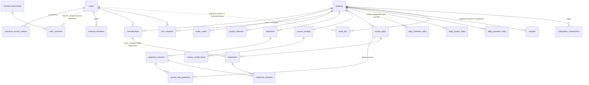

# ADR-0004. Модель данных

**Статус:** Принято
**Дата:** 2026-10-27
**Связано:** ТЗ п. 3.7, 4, 5, 6.5, 7, 9.1.7, 9.2.4, 10, прил. А; CLAUDE.md «Опрос и время», «Персональные данные»; backlog F-019–F-033, F-040–F-049, F-059, F-075–F-077, G-07, G-08, G-16, G-17, Q-14, Q-16–Q-20; решения заказчика В-03, В-04, В-05, В-11, В-13, В-15, В-17, В-19, отмена анонимности (ADR-0005)

## Контекст

Ключевые требования к данным:
- Все метки времени хранятся в UTC. «День опроса» — локальная дата в часовом поясе проекта, тип `date`.
- Набор вопросов дня фиксируется при открытии дня. Изменения настроек действуют со следующего рабочего дня.
- Изменение вопроса, на который уже отвечали, создаёт новую версию. Ответ ссылается на версию. На графике вопрос остаётся одной линией через все версии.
- Участник даёт один ответ в день и может изменить его до закрытия дня. У ответа есть поле `channel`.
- **Анонимных ответов и комментариев нет.** Каждый ответ и комментарий привязан к участнику. Это сознательное отступление от ТЗ п. 6.5 по решению заказчика (ADR-0005).
- Удаление аккаунта, проекта и ответов исключённого участника — **физическое и сразу** (В-05, В-15). Связанные записи журнала удаляются целиком (В-19).
- Код приглашения ищется по HMAC и показывается из зашифрованной копии (В-03).
- После удаления аккаунта остаётся минимальная запись о согласии (В-11, вопрос юристу ЮВ-2).
- Дашборд на 50 участников за 365 дней открывается не дольше 2 с.
- Модули не читают чужие таблицы (ADR-0001).

## Решение

### Общие соглашения

- PostgreSQL, первичные ключи `bigint identity`.
- Все метки времени — `timestamptz`, приложение и БД работают в UTC. Локальная дата — `local_date date`. Часовой пояс проекта — IANA-имя.
- Мультиязычные тексты хранятся в `jsonb` `{"ru", "en"}`.
- Миграции лежат в модуле-владельце и обратимы.
- Изоляция проектов — на уровне приложения (`project_id` + Policy + scope). RLS в R1 нет.
- Колонок `deleted_at` нет: удаление всегда физическое.

### Удаление (В-05, В-15, В-17, В-19)

Удаление выполняется синхронно, в одной транзакции, через реестр `PersonalDataLifecycle` (ADR-0001). Модули вызываются в порядке зависимостей внешних ключей: AI → Analytics → Responses → Survey → Audit → Projects → Identity. После коммита пересчёт агрегатов уходит в очередь `analytics`.

| Действие | Удаляется физически сразу | Остаётся |
| --- | --- | --- |
| Удаление аккаунта (п. 9.2.4) | `users`; `personal_access_tokens`; сессии; `login_codes` по email; `external_identities`; `memberships` и `join_requests` пользователя; `responses` и `response_answers` во всех проектах; `daily_member_stats` его участий; файлы `exports` его проектов; **все записи `audit_log`, где пользователь — автор (`actor_user_id`) или объект (`subject_type` = пользователь/участие и `subject_id` его)**; в R2 — записи словаря псевдонимов | `user_consents` (ЮВ-2) |
| Исключение «оставить ответы» (п. 4.8) | В R2 — запись словаря псевдонимов (В-17) | `memberships` с `removed_at`; ответы показываются как «Бывший участник»; записи журнала (пользователь не удалён) |
| Исключение «удалить ответы» (В-15) | `responses`, `response_answers`, `daily_member_stats` этого участия; в R2 — запись словаря | `memberships` с `removed_at`; записи журнала |
| Удаление проекта (ввод названия + код из письма) | Всё с этим `project_id` во всех модулях, **включая все записи `audit_log` проекта** | Ничего |

- Email уникален через обычный `unique(email)`. Повторная регистрация создаёт новый аккаунт без истории.
- Резервные копии (14 дней) содержат удалённые данные до истечения срока — вопрос юристу ЮВ-3.

### Сущности по модулям

**Identity**
- `users`: `email citext unique`, `name`, `locale`, timestamps.
- `login_codes`: `email`, `code_hash` (HMAC), `purpose` (`login`, `delete_project`), `attempts`, `expires_at`, `consumed_at`.
- `personal_access_tokens` (Sanctum): `name` (браузер, ОС), `client` (`extension`, позже `mobile`), `last_used_at`, `expires_at null`.
- `consent_documents`: `kind`, `version`, `body jsonb`, `published_at`.
- `user_consents`: `user_id` (**без внешнего ключа**), `consent_document_id`, `accepted_at`. Без IP, email и имени. Остаётся после удаления пользователя (В-11, ЮВ-2).
- `external_identities`: `user_id`, `provider`, `external_id`, `unique(provider, external_id)`. Задел, в R1 пустая.

**Projects**
- `projects`: `name`, `timezone`, `default_locale`, `plan` (`pilot`), `work_days smallint[]` (`{1,2,3,4,5}`), timestamps.
- `project_features`: PK `(project_id, feature)`, `enabled`. Значения по умолчанию — из `config/features.php`.
- `memberships`: `project_id`, `user_id`, `role` (`owner`, `admin`, `employee`), `participates`, `approved_at`, `removed_at`, `removal_mode` (`keep`, `delete`). Частичные уникальные индексы: один активный membership на `(project_id, user_id)` и один активный `owner` на проект.
- `invite_codes`: `project_id`, `code_hash` (HMAC, уникальный), `code_encrypted`, `revoked_at`, `created_by` (В-03). Ключи HMAC и шифрования задаются в env, отдельно от `APP_KEY`. При перевыпуске `code_encrypted` старой строки обнуляется.
- `join_requests`: `project_id`, `user_id`, `status` (`pending`, `approved`, `rejected`), `decided_by`, `decided_at`. Одна `pending` на `(project_id, user_id)`.
- Рабочий календарь — сервис `WorkCalendar`.

**Survey**
- `questions`: `project_id null` (null — системный банк), `source_question_id`, `category`, `status` (`active`, `archived`), `current_version_id`.
- `question_versions`: неизменяемый снимок `type`, `text`, `hint`, `required`, `in_index`, `direction`, `settings jsonb`. Варианты выбора — в `settings.options[]` (`{key, text, emoji, weight}`), где `key` — стабильный UUID варианта.
- Правило версий: пока версия не использовалась, правка меняет её на месте; иначе создаётся новая (детали — Q-17).
- `survey_configs`: `mode`, `rotation_count`, `rotation_strategy`, `rotation_state jsonb`.
- `survey_config_items`: `project_id`, `question_id`, `slot` (`pinned`, `pool`), `position`.
- `survey_days`: `project_id`, `local_date`, `status`, `opens_at`, `closes_at`, `closed_at`, `unique(project_id, local_date)`.
- `survey_day_questions`: `survey_day_id`, `position`, `question_id`, `question_version_id`, `source`. **Здесь фиксируется «опрос дня».**

**Responses**
- `responses`: `project_id`, `survey_day_id`, `local_date`, `user_id`, `membership_id`, `channel` (`extension`, `web`, `telegram`), `comment` (≤ 1000 символов, всегда подписан, можно изменить до закрытия дня), `submitted_at`, `updated_at`, `unique(survey_day_id, user_id)`. IP и user-agent не хранятся.
- `response_answers`: `response_id`, `question_id`, `question_version_id`, `value_numeric`, `value_options jsonb`, `value_text`.

**Analytics** (только производные данные)
- `daily_member_stats`: `project_id`, `local_date`, `membership_id`, `expected`, `answered`, `personal_index`. Ожидаемые участники заполняются по `SurveyDayOpened`, одобренные днём — по `MemberJoined` (В-13). Используется как знаменатель участия и для тепловой карты.
- `daily_project_stats`: `team_index`, `respondents`, `expected`, `comments`.
- `daily_question_stats`: `n`, `avg`, `min`, `max`, `distribution jsonb` по вопросу и версии.
- `exports`: `kind` (`csv_answers`, `csv_comments`; `pdf` — R2), `filters`, `status`, `path`, `expires_at` (+24 ч).
- `TeamIndexCalculator` (unit-тесты, п. 7.3); контракт `MetricSource`.

**Audit** — `audit_log`: `project_id`, `actor_user_id null`, `action`, `subject_type`, `subject_id`, `meta jsonb` (только идентификаторы и значения настроек), `created_at`. Хранится 1 год. Индексы по `project_id`, `actor_user_id`, `(subject_type, subject_id)`, чтобы удаление по В-19 выполнялось быстро. Записи без `project_id` (например, действия с аккаунтом) удаляются по автору или объекту.

**Integrations** — `integration_connections`: `project_id`, `type`, `credentials` (`encrypted`), `settings jsonb`. Задел.

**AI (R2)** — `ai_summaries` (текст с псевдонимами, метаданные из п. 8.4.2) и `ai_summary_pseudonyms` (`summary_id`, `pseudonym`, `membership_id`). Запись словаря удаляется при любом исключении участника и при удалении аккаунта (В-17). Если записи для псевдонима нет, в сводке показывается сам псевдоним («Участник 3») без имени.

### ER-диаграмма (основное)

### «Опрос дня» и время (В-13)

1. Scheduler раз в минуту запускает `OpenDueSurveyDays`. Если в TZ проекта наступил рабочий день, а записи о нём нет, задача в одной транзакции создаёт день и фиксирует вопросы (закреплённые плюс N из пула). После коммита публикуется `SurveyDayOpened`. Повторный запуск безопасен благодаря `unique(project_id, local_date)`.
2. Если проект создан в рабочий день, текущий день открывается сразу.
3. Если день ещё не открыт, а запрос уже пришёл, день открывается по этому запросу (лениво, тот же идемпотентный сервис).
4. Участник, одобренный днём, отвечает в тот же день.
5. Ответ принимается, пока `now() < closes_at`, то есть до 00:00 следующего локального дня. `CloseDueSurveyDays` публикует `SurveyDayClosed`.
6. Новый часовой пояс проекта действует с ближайшего ещё не открытого дня.

### Поток ответа

`PUT response` → согласие → Policy → `SurveyResponseService::submit(projectId, userId, Channel, answers, comment)` → валидация по версиям дня → upsert в транзакции → `ResponseSubmitted` после коммита → пересчёт в очереди `analytics`. Цель — p95 ≤ 500 мс.

## Рассмотренные альтернативы

1. **Версии через копию вопроса.** Отклонено: усложняет показ «одной линии через версии».
2. **Отдельная таблица `question_options`.** Отклонено: стабильный ключ варианта всё равно нужен.
3. **Без `survey_days`.** Отклонено: нарушает требование фиксировать набор вопросов дня.
4. **Дашборд напрямую по `response_answers`.** Отклонено: нарушает правило 1.
5. **Мягкое удаление (`deleted_at`).** Отменено заказчиком.
6. **Анонимные комментарии в отдельной таблице.** Отменены заказчиком (ADR-0005).
7. **Журнал с обнулёнными ID после удаления.** Отклонено заказчиком (В-19): записи удаляются целиком.
8. **Код приглашения только хэшем.** Отклонено (В-03).

## Последствия

- (+) Схема проще: нет global scope, отдельной анонимной таблицы и порогов.
- (+) Право на удаление выполняется сразу, после удаления в журнале не остаётся ID субъекта.
- (−) Удаление необратимо (ADR-0008, Р-17).
- (−) Удаление записей журнала стирает и запись о самом удалении проекта, и историю действий удалённого администратора в живых проектах. Это противоречит назначению журнала по ТЗ п. 9.1.7 (ADR-0008, Р-23).
- (−) Порядок удаления между модулями нужно покрыть тестом (Р-22).
- (−) У `user_consents.user_id` нет внешнего ключа, «висящие» ID — сознательное решение.
- Открытые вопросы, которые влияют на детали, но не на схему: Q-14, Q-16, Q-17, Q-18, Q-30.
